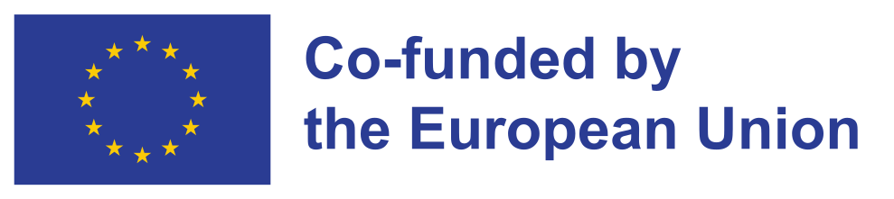

**Computational Thinking makes sense of Mathematics (CTM)** is an Erasmus+
Cooperation Partnership in Higher Education (KA220-HED, project number
2023-1-NO01-KA220-HED-000166744). It runs from January 2024 to December 2026.

## Aims

- Bring computational thinking and programming into first-year university mathematics.
- Develop open teaching materials: Python tutorials, short thematic projects and
  larger group projects based on real applications.
- Share what works through conferences and workshops.
- Promote inclusion and gender balance in STEM.

## Work packages

| WP | Topic |
|---|---|
| WP1 | Project management |
| WP2 | Mapping the use of and need for programming in introductory mathematics courses |
| WP3 | Tutorials for Python in mathematics |
| WP4 | Thematic projects for computational thinking |
| WP5 | Group projects for applied mathematics |

: {.sm}

## Partners

- Norwegian University of Science and Technology (NTNU), coordinator
- Lund University (LU)
- Aalborg University (AAU)
- Technical University of Denmark (DTU)
- University of Oslo (UiO)
- Ruhr University Bochum (RUB)

## Funding

{.ctm-eu-logo fig-alt="Co-funded by the European Union"}

Funded by the European Union. Views and opinions expressed are however those of the
author(s) only and do not necessarily reflect those of the European Union or the
European Education and Culture Executive Agency (EACEA). Neither the European Union
nor EACEA can be held responsible for them.
